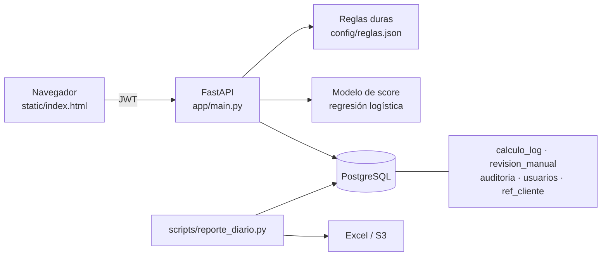

# Calculadora de riesgo (demo)

Proyecto personal: una API con interfaz mínima para decidir solicitudes de crédito con reglas duras, un modelo de score y revisión manual. Cada cálculo queda en base de datos, hay un reporte diario automático en Excel y una propuesta de despliegue en AWS.

**Los datos, las reglas, los umbrales y el modelo son inventados.** Sirve para mostrar arquitectura y forma de trabajo, no para decidir créditos reales. Todo el código se escribió para este repositorio.

## Qué muestra

- Reemplazar una hoja de Excel por una aplicación con acceso por rol y cada resultado guardado con su entrada y la versión de reglas usada.
- Reglas y cortes en un JSON versionado (`config/reglas.json`), separados del código.
- Modelo entrenado al arrancar con datos sintéticos; no hay archivos `.pkl` en el repositorio.
- Flujo de revisión manual: el analista calcula, el supervisor resuelve los casos en zona gris.
- Reporte diario que reemplaza el armado manual: `scripts/reporte_diario.py`.
- Propuesta de despliegue en AWS: [`docs/AWS.md`](docs/AWS.md).

## Arquitectura



## Cómo correrlo

Local, con SQLite y sin Docker:

```bash
python3 -m venv .venv && source .venv/bin/activate
pip install -r requirements-dev.txt
pytest
export JWT_SECRET=$(python -c "import secrets; print(secrets.token_urlsafe(48))")
python -m scripts.sembrar_datos        # imprime una sola vez las claves de los usuarios de ejemplo
uvicorn app.main:app --reload          # http://localhost:8000 · documentación en /docs
```

Con Docker (PostgreSQL + API):

```bash
cp .env.example .env                   # cambia POSTGRES_PASSWORD y JWT_SECRET
docker compose up --build
docker compose exec api python -m scripts.sembrar_datos
```

Reporte diario: `python -m scripts.reporte_diario --fecha 2026-01-15` (sube a S3 con `--s3-bucket`, requiere `boto3`).

## Endpoints

| Método y ruta | Rol | Qué hace |
|---|---|---|
| `GET /health` | público | Estado de la API y la base (lo consulta el balanceador) |
| `POST /api/auth/login` | público | Devuelve un JWT; bloquea la cuenta tras 5 intentos fallidos |
| `GET /api/auth/me` | autenticado | Usuario y rol del token |
| `GET /api/lookup/cliente/{id}` | autenticado | Autocompleta la captura desde la tabla de referencia |
| `POST /api/calcular/{producto}` | autenticado | Reglas + modelo + decisión; guarda el cálculo |
| `GET /api/revisiones` | autenticado | Casos en revisión por estado |
| `POST /api/revisiones/{id}/resolver` | supervisor | Aprueba o rechaza un caso en revisión |
| `GET /api/dashboard/resumen` | autenticado | Conteos por producto, decisión y día |
| `POST /api/usuarios` | supervisor | Crea un usuario (clave de al menos 12 caracteres) |

## Decisiones de diseño

- Cada cálculo se guarda con su entrada, su resultado y la versión de reglas. Así se puede reconstruir cualquier decisión y medir después.
- Las claves usan scrypt de la biblioteca estándar. El login responde en tiempo similar para usuarios que no existen y no revela si la cuenta está bloqueada.
- No hay secretos en el repositorio: `JWT_SECRET` y las credenciales de la base vienen del entorno (en AWS, de Secrets Manager).
- El modelo se entrena con semilla fija en lugar de cargar un archivo binario. Con datos reales conviene versionarlo con su documentación y validarlo con un corte temporal.

## Limitaciones

- Las métricas del modelo (AUC ≈ 0.72, KS ≈ 0.34) miden el generador de datos sintéticos, no riesgo real.
- Las tablas se crean con `create_all`; en producción corresponde usar migraciones (Alembic).
- La interfaz es mínima y no hay limitación de tasa dentro de la app (se propone en el WAF, ver `docs/AWS.md`).
- Las pruebas automáticas corren sobre SQLite; la ruta con PostgreSQL y `docker compose` no está cubierta por CI.

## Licencia

[Apache-2.0](LICENSE). Proyecto personal, sin relación con ningún empleador.
