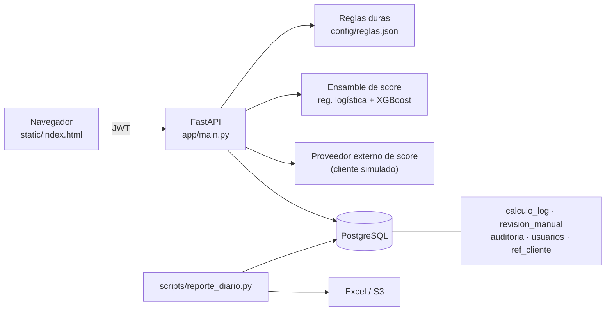

# Calculadora de riesgo (demo)

Proyecto personal: una API con interfaz mínima para decidir solicitudes de crédito con reglas duras, un modelo de score y revisión manual. Cada cálculo queda en base de datos, hay un reporte diario automático en Excel y una propuesta de despliegue en AWS.

**Los datos, las reglas, los umbrales y el modelo son inventados.** Sirve para mostrar arquitectura y forma de trabajo, no para decidir créditos reales. Todo el código se escribió para este repositorio.

## Qué muestra

- Reemplazar una hoja de Excel por una aplicación con acceso por rol y cada resultado guardado con su entrada y la versión de reglas usada.
- Reglas y cortes en un JSON versionado (`config/reglas.json`), separados del código.
- Ensamble de modelos (regresión logística + XGBoost) entrenado al arrancar con datos sintéticos; no hay archivos `.pkl` en el repositorio. Cada cálculo guarda la probabilidad y el decil de cada modelo.
- Cliente de un proveedor externo de score (simulado): si el proveedor no responde, el caso se degrada a revisión manual en lugar de decidirse sin el dato (`SCORE_EXTERNO=off` lo simula).
- Módulo de administración de usuarios: alta, listado, activar/desactivar (invalida tokens vigentes) y cambio de clave.
- Flujo de revisión manual: el analista calcula, el supervisor resuelve los casos en zona gris.
- Reporte diario que reemplaza el armado manual: `scripts/reporte_diario.py`.
- Propuesta de despliegue en AWS: [`docs/AWS.md`](docs/AWS.md).

## Arquitectura



## Cómo correrlo

Local, con SQLite y sin Docker:

```bash
python3 -m venv .venv && source .venv/bin/activate
pip install -r requirements-dev.txt
pytest
export JWT_SECRET=$(python -c "import secrets; print(secrets.token_urlsafe(48))")
python -m scripts.sembrar_datos        # imprime una sola vez las claves de los usuarios de ejemplo
uvicorn app.main:app --reload          # http://localhost:8000 · documentación en /docs
```

Con Docker (PostgreSQL + API):

```bash
cp .env.example .env                   # cambia POSTGRES_PASSWORD y JWT_SECRET
docker compose up --build
docker compose exec api python -m scripts.sembrar_datos
```

Reporte diario: `python -m scripts.reporte_diario --fecha 2026-01-15 --tz America/Mexico_City` (el corte del día usa esa zona horaria; `--s3-bucket` lo sube además a S3).

## Endpoints

| Método y ruta | Rol | Qué hace |
|---|---|---|
| `GET /health` | público | Estado de la API y la base (lo consulta el balanceador) |
| `POST /api/auth/login` | público | Devuelve un JWT; 5 intentos fallidos bloquean la cuenta 15 minutos |
| `GET /api/auth/me` | autenticado | Usuario y rol del token |
| `GET /api/lookup/cliente/{id}` | autenticado | Autocompleta la captura desde la tabla de referencia |
| `POST /api/calcular/{producto}` | autenticado | Reglas + modelo + decisión; guarda el cálculo |
| `GET /api/revisiones` | autenticado | Casos en revisión por estado (los datos del caso solo para supervisores o quien lo capturó) |
| `POST /api/revisiones/{id}/resolver` | supervisor | Aprueba o rechaza un caso en revisión (nunca quien capturó el cálculo) |
| `GET /api/dashboard/resumen` | autenticado | Conteos por producto, decisión y día, estado de las revisiones y métricas de los modelos |
| `POST /api/usuarios` | supervisor | Crea un usuario (clave de al menos 12 caracteres) |
| `GET /api/usuarios` | supervisor | Listado para administración (sin hashes) |
| `PATCH /api/usuarios/{usuario}/activo` | supervisor | Activa o desactiva una cuenta (nunca la propia); ambas acciones invalidan los tokens emitidos antes |
| `POST /api/usuarios/me/clave` | autenticado | Cambia la clave propia verificando la actual; devuelve un token nuevo y revoca los anteriores. Los intentos fallidos cuentan para el bloqueo |

## Decisiones de diseño

- Cada cálculo se guarda con su entrada, su resultado, la versión de reglas y la probabilidad y el decil de cada modelo del ensamble. Así se puede reconstruir cualquier decisión y medir después.
- El score final es el promedio de la regresión logística y el XGBoost; cada modelo aporta además su decil con cortes de cuantiles sobre el train. El monto ofertado se ajusta por un factor según el decil (`factor_oferta_decil` en las reglas).
- El score del proveedor externo es insumo, no sustituto: si viene bajo el caso va a revisión manual, y si el proveedor no responde también, en lugar de decidir sin el dato.
- Las claves usan scrypt de la biblioteca estándar. El login responde en tiempo similar para usuarios que no existen y no revela si la cuenta está bloqueada; el intento se reserva en la base con un UPDATE condicional antes de verificar la clave, así una ráfaga concurrente no consigue más verificaciones que el límite, y un login correcto no borra un bloqueo que llegó mientras verificaba. El bloqueo expira solo (15 minutos).
- Los casos en zona gris los resuelve un supervisor distinto de quien capturó el cálculo (maker-checker), con un UPDATE condicional para que dos resoluciones simultáneas no se pisen.
- No hay secretos en el repositorio: `JWT_SECRET` y las credenciales de la base vienen del entorno (en AWS, de Secrets Manager).
- El modelo se entrena con semilla fija en lugar de cargar un archivo binario. Con datos reales conviene versionarlo con su documentación y validarlo con un corte temporal.

## Limitaciones

- Las métricas de los modelos (AUC ≈ 0.70–0.72, KS ≈ 0.31–0.34) miden el generador de datos sintéticos, no riesgo real. Como el generador es un proceso logístico, la regresión es el modelo "verdadero" y el XGBoost solo la alcanza con regularización fuerte; con datos reales la relación suele invertirse.
- El proveedor externo de score es una simulación determinista; en producción sería una llamada HTTPS con timeout corto, reintentos y bitácora de consumo.
- Las tablas se crean con `create_all`; en producción corresponde usar migraciones (Alembic).
- La interfaz es mínima y no hay limitación de tasa dentro de la app (se propone en el WAF, ver `docs/AWS.md`); cada intento de login anónimo cuesta un scrypt y una fila de auditoría.
- La revocación de sesiones es por versión de token (claim `ver`): cambiar la clave o desactivar/reactivar una cuenta invalida todos los tokens emitidos antes, pero no hay revocación individual de un token concreto. Una cuenta bloqueada tampoco puede usar sus tokens vigentes; el intercambio es deliberado (contener una cuenta posiblemente comprometida pesa más que la disponibilidad) y permite que cualquiera que conozca un usuario lo deje fuera 15 minutos con intentos fallidos. En producción, el límite de tasa por IP del WAF frena eso antes de llegar a la app.
- `config/reglas.json` se carga una vez por proceso; aplicar cambios requiere reiniciar la API (cada cálculo guarda la versión que lo decidió).
- Las pruebas automáticas corren sobre SQLite; la ruta con PostgreSQL y `docker compose` no está cubierta por CI.

## Licencia

[Apache-2.0](LICENSE). Proyecto personal, sin relación con ningún empleador.
