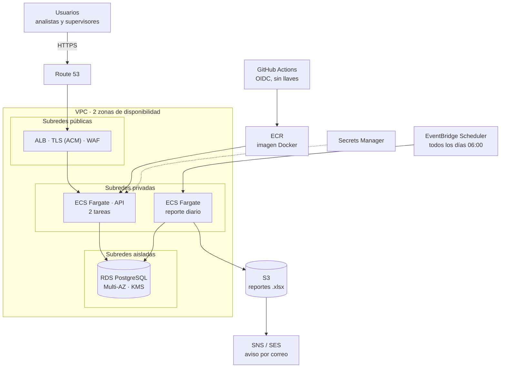

# Propuesta de despliegue en AWS (ejemplo)

Arquitectura de referencia para llevar esta calculadora de un `docker compose` local a AWS, con alta disponibilidad moderada, secretos fuera del código y reportes automáticos. No incluye infraestructura como código: el diagrama es el punto de partida para escribirla (Terraform o CDK).

## Diagrama

Versión en imagen: [`img/aws.png`](img/aws.png).

El job del reporte usa la misma imagen que la API y, como ella, lee sus secretos de Secrets Manager. Los VPC endpoints (ECR, S3, Secrets Manager y Logs) mantienen ese tráfico dentro de la red de AWS.

## Componentes

| Servicio | Para qué | Por qué así |
|---|---|---|
| Route 53 + ACM | Dominio y certificado TLS | El balanceador termina HTTPS; la app solo habla HTTP interno |
| ALB + WAF | Entrada única, `/health` como chequeo, límites de tasa y reglas básicas | La API no se expone directo; el WAF frena abuso de `/api/auth/login` |
| ECS Fargate | Corre la misma imagen que en local, 2 tareas en 2 zonas | Sin servidores que parchear; escala por CPU |
| RDS PostgreSQL | `usuarios`, `calculo_log`, `revision_manual`, `auditoria`, `ref_cliente` | Multi-AZ, backups automáticos, cifrado con KMS; subredes sin ruta a internet |
| Secrets Manager | `JWT_SECRET` y credenciales de la base | Se inyectan como variables de entorno de la tarea; no hay secretos en la imagen ni en el repo |
| EventBridge Scheduler + ECS | Ejecuta `python -m scripts.reporte_diario --s3-bucket …` cada mañana | Sustituye el armado manual del reporte; el resultado llega a S3 antes de que empiece la operación |
| S3 + SNS/SES | Guarda el Excel y avisa por correo | Versionado y cifrado; el enlace se comparte con URL prefirmada |
| CloudWatch | Logs, métricas y alarmas | Alarmas sugeridas: 5xx del ALB, CPU de las tareas, almacenamiento libre de RDS, fallo de la tarea programada |
| GitHub Actions + ECR | Compila, prueba y publica la imagen | OIDC con rol de AWS: no se guardan llaves de acceso en GitHub |

## Ambientes

- **QA y producción en cuentas AWS separadas** (AWS Organizations). Misma imagen, distinta configuración: lo que se prueba en QA es lo que se promueve.
- Flujo: PR → pruebas (`pytest`) → imagen en ECR con etiqueta del commit → despliegue a QA → aprobación → mismo digest a producción.
- Reversa: se vuelve a desplegar la etiqueta anterior; la base cambia solo con migraciones compatibles hacia atrás (en este demo se usa `create_all`; en producción, Alembic).

## Seguridad

- Subredes privadas para la API y aisladas para la base; los grupos de seguridad solo permiten ALB → ECS y ECS → RDS.
- Acceso administrativo por SSM Session Manager, sin puertos de administración abiertos.
- Roles de IAM por tarea con permisos mínimos (la tarea del reporte solo escribe en su prefijo de S3).
- Cifrado en tránsito (TLS, `sslmode=require` hacia RDS) y en reposo (KMS en RDS y S3).
- Bitácora de acceso y de cambios en la tabla `auditoria`, además de CloudTrail para la cuenta.

## Variante de bajo costo

Una instancia EC2 pequeña con Docker Compose (la misma `docker-compose.yml`), RDS de una sola zona y acceso por SSM. Cuesta mucho menos, pero no tiene alta disponibilidad: si la instancia cae, el servicio se detiene hasta que se reemplace. Sirve para QA o para una primera etapa.

## Costos

Con decenas de casos por hora, la carga es mínima y el costo lo dominan los componentes fijos (balanceador, RDS Multi-AZ, NAT o VPC endpoints), no el cómputo. Para estimarlo con precio vigente, usar la calculadora de precios de AWS con los servicios de la tabla.
